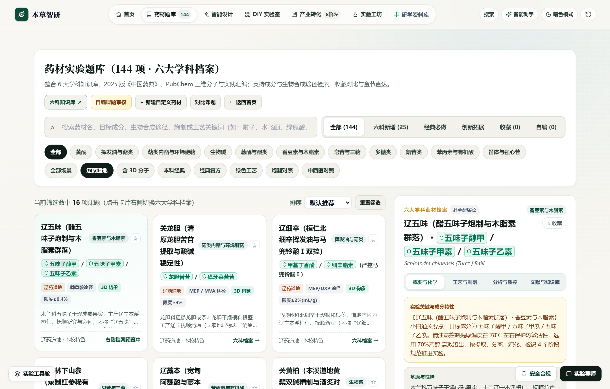
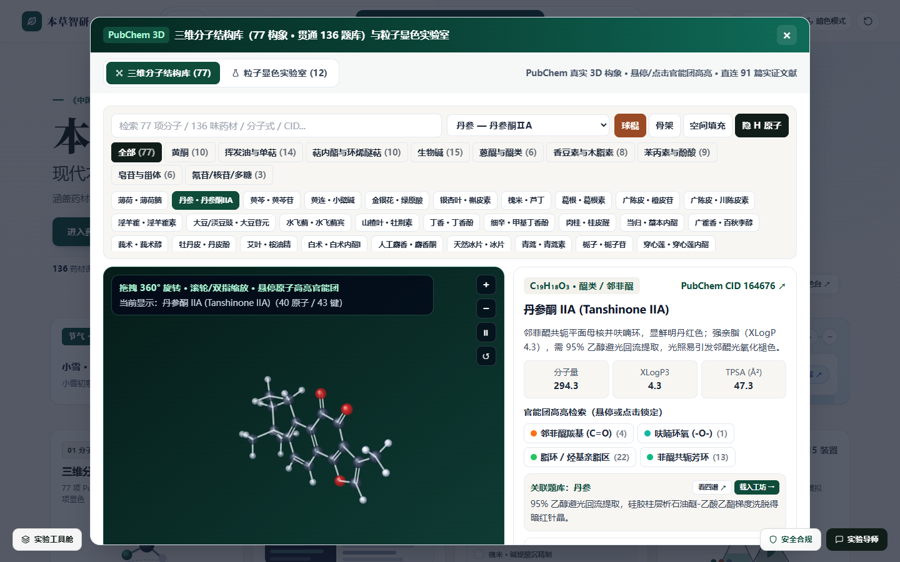

# 本草智研（bencaozhiyan）

面向辽宁中医药大学药学、中药学、制药工程等相关专业课程教学与实验预习编写的在线工作台。平时主要用来查药材指标与药典限度、换算提取投料和溶剂比例、预习装置搭法、对照四谱与显色反应，以及排版导出实验报告；后面也加上了从小试提取到制剂处方、质量评价和中试放大的推演练习。

本项目由个人独立设计与开发，**辽宁中医药大学专属**，仅限校内教学、实验预习与非商业学术交流使用，**禁止任何商业用途**（详见 [LICENSE](./LICENSE)）。

- 在线访问：<https://bencaozhiyan-xixiyu.pages.dev/>
- 备用地址：<https://bencaozhiyanxxy.pages.dev/>

## 界面截图

| 首页（浅色） | 首页（深色） |
| :---: | :---: |
|  |  |

| 辽药道地与六科药材档案 | 小试至中试转化练习（辽五味） |
| :---: | :---: |
|  |  |

| 三维减压旋转蒸发实操 | 三维 HPLC-DAD 定量实操 |
| :---: | :---: |
|  |  |

| 分子三维结构查看 | 六步实验工坊 |
| :---: | :---: |
|  |  |

## 功能说明

整个站点按使用场景拆成了六个工作区和几组按需打开的辅助工具：

**药材题库与学科资料**  
目前整理了 144 个单味药及复方实验课题（按黄酮、生物碱、蒽醌、挥发油、皂苷、苯丙素等 11 类划分），参照 2025 年版《中国药典》核对了基原、指标成分与含量限度，并专门增补了辽五味、关龙胆、辽细辛、桓仁林下山参、辽藁本、关黄柏、关防风、辽刺五加等辽产道地药材的炮制与质控课题。支持按道地药材、生物合成途径、炮制对照、绿色工艺等条件筛选，也可以任选两个课题做横向对比。题库外还挂了 100 篇参考文献、48 个高校与药企实验案例，以及中药化学、中药制剂、制药工艺、分析化学、仪器分析、制剂分析 6 册基础资料检索。

**六步实验工坊**  
按实验课常规流程分成「选材—定题—原理—装置—数据—报告」六步。左侧改投料量、料液比、温度或提取次数时，右侧的溶剂耗量、收率估算和五维工艺雷达会实时重算；数据页内置了 UV-Vis 标准曲线最小二乘拟合（$A=kC+b, R^2$）和正交极差计算；最后一步可勾选需要的章节，按 A4 版式打印或导出 Word / PNG 长图。实验草稿默认自动存在浏览器本地，也可以通过口令或链接同步到云端跨设备打开。

**DIY 自由配方与失误排查**  
支持从 144 个药材、15 种溶剂体系和 8 类提取装置里自由组合参数，本地直接算出相似相溶极性匹配度、热降解拐点和预计收率，并用烧瓶示意图提示可能出现的现象（如多糖醇沉浑浊、皂苷起泡、黄芩温水酶解变绿等）。另外单独做了 7 个常见实验失误（暴沸冲料、未放气、乳化、热敏分解等）的排查练习，以及复方配伍、TLC 三光源显色、MSDS 废液分类等小工具。

**三维分子、显色与三维实验室**  
离线收录了 77 个常用中药成分的 PubChem 三维构象坐标，可切换球棍、骨架、空间填充模式并按官能团高亮显示；配套 12 个经典试管显色反应动画（带空白对照管）、覆盖 11 类成分的 UV / IR / ¹H-NMR / MS 交互谱图（支持缩放、诊断试剂位移对照与猜峰练习），以及基于真实溶剂密度的分液漏斗分层模拟。Three.js 三维虚拟实验室在同一间实验室内布置了试剂架、分析天平、通风橱、减压旋蒸台、液相色谱台和前处理台六个工位，提供「丹参 95% 乙醇避光回流提取」「50℃ 减压旋转蒸发浓缩」「HPLC-DAD 外标法定量测定」三套 7 步实操流程，内置未通冷凝水禁加热/禁抽真空、先升瓶放气后停泵防倒吸、未排气泡或未平衡基线禁进样等操作互锁检查。

**小试至中试转化训练**  
内置丹参、黄芩、薄荷、延胡索、辽五味（醋五味子护肝安神木脂素颗粒）5 个示范项目，也可导入题库里的其他药材，按产品定位、炮制对照、工艺路线加权对比、浓缩干燥热敏保留率估算、剂型与辅料选择、三批 RSD 质量评价、100 g～100 kg 非线性放大核算与偏差调查八个环节做连贯推演。界面上对每项参数标明了来源类别（药典标准、法规文件、文献教材、用户实测或模型推算），避免把估算值当成法定标准。

**模型辅助编排与自建题审核**  
接入了智谱 GLM、腾讯云 TokenHub 和讯飞星辰三个接口，提供 5 套固定实验模板用于方案初稿生成、已有方案检查和实验答疑。为避免未核实的生成内容直接混进题库，自建方案只保存在当前会话草稿中，只有通过五维规则检查且总分达到 90 分以上才允许写入自编题库。

## 设计取舍与实现思路

项目在开发过程中做过几次比较大的调整，主要围绕稳定性、加载速度和教学准确性展开：

1. **本地规则计算优先，减少对外部模型接口的依赖**  
   早期版本把方案推演高度绑在单一模型接口上，实际用下来经常遇到长文本超时、免费额度限流，或者返回的 JSON 少括号导致前端报错。后来把极性匹配、动力学曲线、密度分层、MSDS 规则和 90 分评分全部改成了纯本地计算逻辑；模型只负责文本编排与答疑，并在前端写了栈式 JSON 容错解析和本地兜底，就算断网也不影响查题库、算参数和导报告。

2. **从单页多脚本改成多工作区与 Vite 按需分包**  
   最初纯静态版本在 `index.html` 里直接引了 27 个 `<script>` 文件，未压缩体积约 2.7 MB，移动端 4G 下 Lighthouse 性能只有 44 分，而且所有模块挤在同一个长页里很难找。后续引入 Vite 6 做了多轮拆分（记录在 [optimization-log.md](./optimization-log.md)），保留原有原生 JS 模块写法不引入重型框架，把早期散落在根目录的脚本统一归入 `src/core/` 与 `src/styles/`，并将 Three.js、三维实验室场景、77 个分子的三维数据、六科资料库、Chart.js、html2canvas、DIY 沙盒和转化模块全部拆成异步分包，点开对应功能时才加载。

3. **外部科学数据离线化与国内网络适配**  
   国内网络直接请求境外公共 CDN 或实时调 PubChem 接口经常超时。因此第三方前端库均已纳入本地构建产物，77 个成分的 PubChem 3D SDF/JSON 坐标也在构建前用脚本一次性拉取并做官能团拓扑标记后存为静态模块；三维分子视图用 Canvas 2D 透视投影与深度排序实现，比每开一个弹窗都建 WebGL 上下文更省内存，手机浏览器也能跑满 60 帧。

4. **服务端代理隔离密钥与多通道切换**  
   仓库和前端代码不包含任何明文密钥。线上通过 Cloudflare Pages Functions 提供 `/api/ai-proxy` 和 `/api/drafts` 两个接口：前者从服务端环境变量读取密钥，做来源白名单校验与单 IP 限流（24 次/分钟），以 SSE 流式转发避免网关超时，并在主模型返回 429/5xx 时自动切到备选模型；后者基于 Cloudflare KV（或 D1）存取实验草稿。GitHub Actions 每次推送会自动执行语法校验、密钥扫描、Vite 生产构建与异步分包完整性检查。

## 技术栈与目录结构

- **前端**：原生 JavaScript（ES2020 模块）、HTML5 Canvas 2D、Three.js（三维实验室场景）、Chart.js（数据拟合图表）、html2canvas（报告长图导出）、Tailwind CSS 3
- **构建与检查**：Vite 6、PostCSS、rollup-plugin-visualizer、GitHub Actions（自动构建与分包检查）
- **边缘接口与存储**：Cloudflare Pages Functions、Cloudflare KV（`TCM_DRAFTS_KV`）/ 可选 D1

```text
bencaozhiyan/
├── index.html                        # 页面骨架与工坊主体结构
├── manifest.webmanifest              # PWA 配置清单
├── vite.config.js                    # Vite 构建、分包规则与 sitemap 生成
├── tailwind.config.js                # Tailwind CSS 扫描与构建配置
├── _headers                          # 静态资源与接口缓存头配置
├── LICENSE                           # 辽宁中医药大学专属非商业许可说明
├── .github/workflows/validate.yml    # GitHub Actions 密钥检查、生产构建与分包校验
├── src/
│   ├── main.js                       # Vite 打包主入口
│   ├── core/                         # 六步工坊、工作区门户、转化训练、分子投影与四谱核心逻辑
│   ├── data/                         # 离线 PubChem 3D 分子数据与六科知识库数据
│   ├── lib/                          # 轻量图标与第三方依赖按需加载器
│   ├── modules/                      # 首页、节气、Three.js 三场景实验室、道地药材、配方沙盒等模块
│   ├── routes/                       # 各异步分包的动态加载入口
│   └── styles/                       # 全局与分包样式、深浅色主题细节覆盖
├── functions/api/
│   ├── ai-proxy.js                   # 多模型反向代理、限流与自动切换
│   ├── drafts.js                     # 实验草稿云端存取接口
│   └── drafts.schema.sql             # 可选 D1 数据库表结构
├── docs/screenshots/                 # README 展示截图
├── optimization-log.md               # Vite 改造与分包优化实测记录
└── progress.md                       # 各功能模块开发与修复记录
```

## 开发与迭代记录

根据仓库提交历史（2026-11-21 至 2026-11-26），大致演进过程如下：

- **2026-11-21（基础工坊成型）**：从最初的单页实验统计台改为六步实验设计工坊（`d9cd637` ~ `3c55182`），理顺了投料换算、步骤切换和旧存档兼容问题。
- **2026-11-22（题库扩充与流式代理）**：将同步接口改为 SSE 流式透传解决网关 502 超时（`ef60b51`），加上栈式 JSON 容错解析（`72a759a`）；同日陆续补齐了 MSDS/TLC/正交计算工具、四谱与标曲拟合、15 套交互装置、DIY 实验室和项目中枢（`fabd4d5` ~ `108dc3f`）。
- **2026-11-23（多工作区拆分与转化主线）**：去除境外公共 CDN 依赖改为本地加载（`f2c12f9`），将单页拆成多工作区结构（`4483b28`），迁至 Cloudflare Pages（`6ec7bec`），增加自编课题 90 分准入检查（`4f60d27`）与八阶段产业转化训练模块（`a492090`），并修复了搜索框中文输入法打字被 `innerHTML` 重绘打断的问题（`f88c6ce`）。
- **2026-11-24（Vite 打包改造与学科资料扩充）**：引入 Vite 完成 12 轮按需分包优化与云端草稿存储（`7cb66ef`），上线新版首页、第一批 PubChem 3D 分子与 Three.js 实验室（`9ce53dd`），并将题库扩至 136 项、接入六大学科知识库（`d38152c`、`f172225`）。
- **2026-11-25（多模型代理、三维分子扩充与细节修正）**：补齐梨形分液漏斗物理模拟、四谱工作站、五维雷达驾驶舱、自由配方沙盒、失败分支练习及知识图谱探索模块（`ba924b9` ~ `0032b03`）；将服务端代理扩展为智谱、腾讯、讯飞三通道切换并统一 5 套实验模板（`c94485a` ~ `130eb19`）；把三维分子库扩充到 77 个真实 PubChem 构象、移除不实用的 AR 卡片（`26096b8`），并修正了六步工坊侧栏与移动端步进条遮挡、暗色雷达文字对比度等问题（`520c8e5` ~ `0f151d7`）。
- **2026-11-26（三维旋蒸/液相场景补齐、辽药道地专题与目录规整）**：在 Three.js 三维实验室中补齐「减压旋转蒸发浓缩」与「HPLC-DAD 外标法定量测定」两套 7 步流程及防倒吸、排气泡等安全互锁；新增辽五味、关龙胆、辽细辛、桓仁林下山参等 8 组辽产道地药材课题、参考文献、本校教学案例及第 5 个转化示范项目（全库扩至 144 题 / 100 篇文献 / 48 个案例）；将早期遗留在根目录的脚本与样式全部归入 `src/core/` 和 `src/styles/`，并升级 GitHub Actions 自动执行 Vite 构建与分包校验。

## 本地运行与部署

环境要求：Node.js 18 及以上。

```bash
git clone https://github.com/xixiyu954/bencaozhiyan.git
cd bencaozhiyan
npm install

# 本地开发预览（http://localhost:5173）
npm run dev

# 生产构建（输出至 dist/）
npm run build
npm run preview
```

若部署到 Cloudflare Pages：
1. 关联仓库 `main` 分支，构建命令填 `npm run build`，输出目录填 `dist`。
2. 如需云端保存草稿，在 Pages 项目 `Settings -> Functions -> Bindings` 中绑定 KV 命名空间 `TCM_DRAFTS_KV`（或 D1 数据库 `TCM_DRAFTS_DB`）。
3. 如需启用云端模型功能，在 `Settings -> Environment variables` 中配置服务端密钥 `ZHIPU_API_KEY`、`TENCENT_API_KEY`、`XUNFEI_API_KEY`（配置其中任意一个或多个均可运行，未配置时自动使用本地规则）。

## 当前使用边界与后续维护方向

- Three.js 三维实验室目前已做完「回流提取—减压旋蒸—HPLC 定量」这条主线的三套 7 步流程，挥发油水蒸气蒸馏、大孔吸附树脂柱层析等其余单元操作暂在二维交互装置页中提供。
- 转化训练模块里的设备传热折算与中试损耗率目前采用教材经验区间估算，后续会结合校内中试实训课的实测台账继续修正参数范围。

## 版权与使用说明

- 本项目由作者本人独立设计开发，**辽宁中医药大学专属**，仅限非商业性质的课程教学、实验预习与学术交流，**严禁任何商业用途**，详细条款见 [LICENSE](./LICENSE)。
- 平台内的计算结果、模拟动画与辅助生成方案仅供参考，实际实验操作请严格遵守最新版《中国药典》、实验室安全规范与指导教师要求。
- 问题反馈或药典数据勘误请联系：`Chenovo495666@163.com`。
