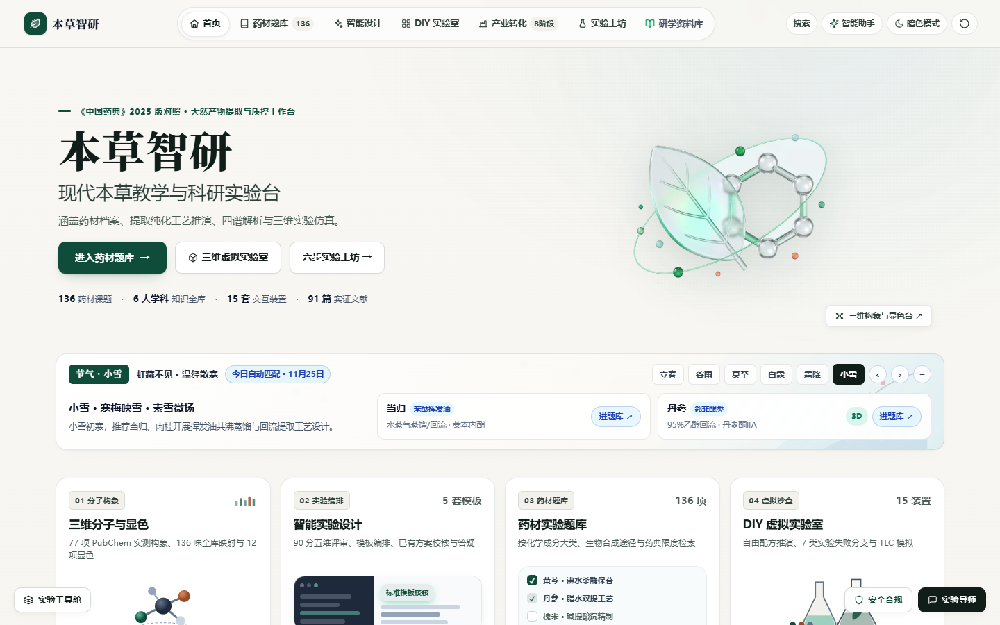
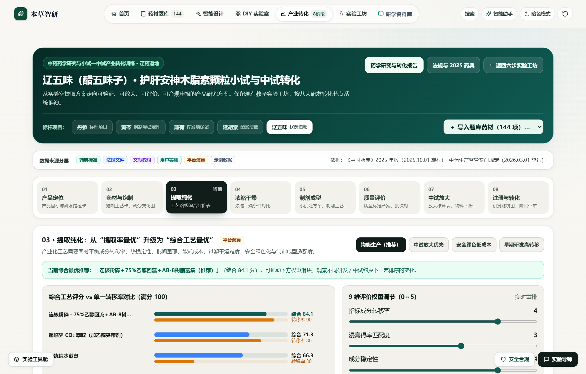
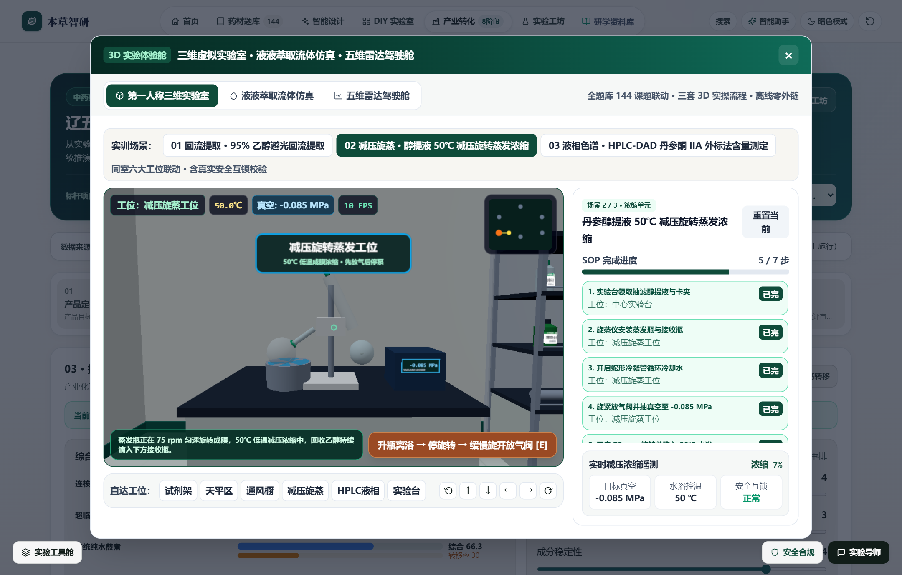
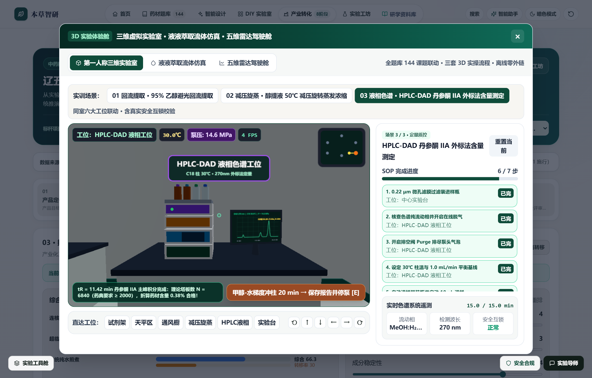
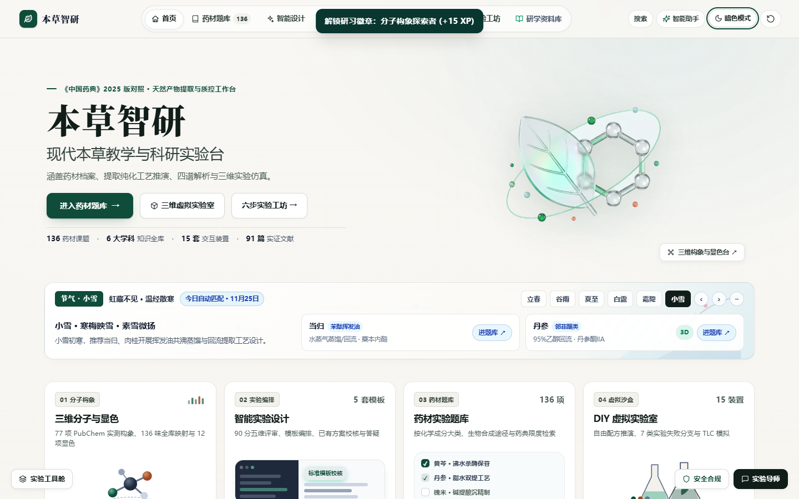

# 本草智研（bencaozhiyan）

面向辽宁中医药大学药学、中药学、制药工程等相关专业课程教学、实验预习与科研训练编写的在线实验设计工作台。

日常实验课前，学生常需要在《中国药典》、教材、文献和实验讲义之间来回翻查基原限度、换算投料量与溶剂体积、核对装置搭法和注意事项，课后还要手工拟合标准曲线、整理实验报告；进入高年级综合性实验或毕业专题时，还会遇到实验室小试参数直接放大到中试提取罐失真的问题。这个项目把这些分散的环节收拢到了同一个网页工作台里，围绕「查资料—算参数—看仿真—排失误—做放大—导报告」提供一套可离线推演、数据来源透明的辅助工具。

本项目由个人独立设计与开发，**辽宁中医药大学专属**，仅限校内课程教学、实验预习与非商业学术交流使用，**禁止任何商业用途**（详见 [LICENSE](./LICENSE)）。

- 在线访问：<https://bencaozhiyan-xixiyu.pages.dev/>
- 备用地址：<https://bencaozhiyanxxy.pages.dev/>
- 代码仓库：<https://github.com/xixiyu954/bencaozhiyan>

---

## 项目定位与适用人群

- **本科实验课学生**：课前检索药材化学成分、理化性质与 2025 年版《中国药典》含量限度，在三维实验室和二维装置图里预习回流、旋蒸、分液、液相色谱的操作顺序与安全禁忌；课后完成 UV 标准曲线回归、正交极差计算，按 A4 版式排版导出实验报告。
- **高年级与科研训练学生**：对自选药材和溶剂做极性匹配与收率预判，按八个研发环节练习从 100 g 小试提取、浓缩干燥、颗粒/片剂处方成型到 100 kg 中试放大的工艺折算与偏差排查（CAPA），并用五维规则自查实验方案漏洞。
- **授课与实验指导教师**：课堂投影演示 77 个标志性成分的三维构象与官能团反应位点、12 项经典试管显色对照、11 类成分四谱特征峰归属及典型违规操作（如未通冷凝水加热、旋蒸负压直接关泵倒吸）的后果。

---

## 界面预览

| 首页（浅色） | 首页（深色） |
| :---: | :---: |
|  |  |

| 辽药道地专题与六科药材档案 | 小试至中试转化训练（辽五味） |
| :---: | :---: |
|  |  |

| 三维减压旋转蒸发实操 | 三维 HPLC-DAD 定量实操 |
| :---: | :---: |
|  |  |

| 分子三维构象与官能团高亮 | 六步实验设计工坊 |
| :---: | :---: |
|  |  |

---

## 主要功能模块

全站拆分为六个主工作区和若干按需加载的专题弹窗：

### 1. 药材实验题库与辽药道地档案（`bank`）
- 收录 **144 个单味药及经典复方实验课题**，覆盖黄酮、生物碱、蒽醌与醌类、苯丙素与香豆素/木脂素、挥发油与萜类、环烯醚萜与萜类内酯、三萜与甾体皂苷、强心苷、氰苷、多糖、有机酸 11 大类，逐项核对 2025 年版《中国药典》植物基原、指标成分与含量限度。
- 结合辽宁中医药大学实验教学特色，专门整理了 **辽五味（醋五味子木脂素群落）、清原关龙胆、桓仁辽细辛（挥发油与马兜铃酸 I 双控）、桓仁林下山参（蒸制红参稀有皂苷转化）、宽甸辽藁本、本溪关黄柏、阜新关防风、辽东刺五加** 等辽产道地药材专题（可通过「辽药道地」标签筛选，共匹配 16 项东北/辽宁道地课题）。
- 配套 **100 篇实证参考文献**、**48 个高校与药企中试案例**，以及《中药化学》《中药药剂学》《中药制药工程原理与设备》《分析化学》《仪器分析》《中药制剂分析》**6 册学科基础资料与实践汇编**全文检索，支持任意两味药材的工艺与质控参数并排对比。

### 2. 六步实验设计工坊（`workflow`）
- 按实验课标准流程划分为 **「01 选材 → 02 定题与工艺 → 03 化学原理与四谱 → 04 装置仿真 → 05 数据处理 → 06 报告导出」** 六步。
- 调整投料质量、粉碎粒度、料液比、溶剂浓度、温度或提取时间时，右侧实时重算总溶剂耗量、预估得率与五维工艺评分（效率、纯度、温和度、安全、绿色环保）。
- 内置 15 套二维动态提取分离装置图、UV-Vis 标准曲线最小二乘拟合器、$L_9(3^4)$ 正交试验极差分析表；生成的实验报告支持按章节勾选打印 A4 PDF、导出 Word（`.doc`）或高清 PNG 长图，并可通过口令将草稿同步至云端跨设备续写。

### 3. DIY 自由配方沙盒与失误排查（`diy`）
- 支持在 **144 味药材 × 15 种溶剂体系 × 8 类提取装置** 中自由组合条件，本地计算极性匹配度、热敏降解损耗与预计收率，并在烧瓶可视化面板中给出直观实验现象提示（如水提多糖加醇浑浊沉淀、皂苷水溶液剧烈起泡、黄芩冷水浸泡酶解变绿等）。
- 独立设置 **7 类典型实验失误分支练习**（忘记加沸石暴沸冲料、分液漏斗未放气喷液、皂苷/碱液剧烈振摇乳化、热敏内酯高温开环等），配套 TLC 薄层色谱三光源（日光 / 254 nm / 365 nm / 显色剂）模拟与实验室 MSDS 危化品废液分类工具。

### 4. 三维虚拟实验室、分子构象与四谱工作站（按需分包）
- **Three.js 第一人称三维虚拟实验室**：在同一间 10 m × 8 m 实验室内布置试剂架、防震分析天平、排风通风橱、中心前处理台、减压旋蒸工位与液相色谱工位，完整实现三套 7 步实训流程：
  1. **丹参 95% 乙醇避光回流提取**（领料 → 精密称量 50.00 g → 装瓶投沸石 → 搭球形冷凝管与锡箔避光 → 下进上出通冷凝水 → 70℃ 微沸回流 → 先断电冷却后停水）；
  2. **丹参醇提液 50℃ 减压旋转蒸发浓缩**（领抽滤液 → 斜置挂瓶扣卡夹 → 通蛇形管冷却水 → 锁紧放气阀抽真空至 `-0.085 MPa` → 75 rpm 旋转成膜入浴浓缩 → 先升瓶停转并旋开放气阀通大气 → 最后停真空泵收稠膏）；
  3. **HPLC-DAD 丹参酮 IIA 外标法定量测定**（0.22 μm 有机系微孔滤膜过膜装瓶 → 在线真空脱气 → 3.0 mL/min Purge 排尽泵头气泡 → 30℃ C18 柱与 270 nm 基线平衡 → 10 μL 自动进样 → 三维工作站屏幕实时绘出 `tR = 11.42 min, N = 6840` 主峰并积分 → 90% 甲醇过渡冲柱停机）。
- **77 项 PubChem 实测三维分子库与 12 项显色动画**：支持球棍、骨架、范德华空间填充三种模式切换、氢原子显隐及官能团原子组悬停锁定高亮；显色台采用双试管（空白对照管 vs 反应管）对比展示盐酸-镁粉、Borntrager、碘化铋钾、Kedde、异羟肟酸铁等 12 个定性检识反应。
- **11 大类四谱交互解析与分液流体模拟**：提供 UV、IR、$^1\text{H-NMR}$、MS 四谱缩放检视、诊断试剂位移对照与猜峰训练，以及梨形分液漏斗双相密度分层与分配萃取动态模拟。

### 5. 八阶段中药产业转化训练（`translation`）
- 内置 **丹参、黄芩、薄荷、延胡索、辽五味（醋五味子护肝安神木脂素颗粒）5 个完整示范项目**，并支持将题库任意药材一键导入转化工作区。
- 串联「01 产品定位 → 02 药材与炮制 → 03 提取纯化路线加权优选 → 04 浓缩干燥热敏保留核算 → 05 制剂处方与成型辅料 → 06 三批中试质量标准与 RSD 评价 → 07 100 g 至 100 kg 非线性工程放大与物料成本核算 → 08 注册路径与偏差调查（CAPA）」八个阶段，可导出完整药学研究与转化设计书。

### 6. 模型辅助编排与 90 分自建题准入（`ai`）
- 统一提供 5 套实验模板，支持云端多模型（智谱 GLM / 腾讯云 TokenHub / 讯飞星辰）流式生成初稿、已有方案合规校核、右侧实验导师实时答疑与右下角安全合规督察。
- 学生自建或模型辅助生成的课题必须先通过本地五维规则评审且 **总分 ≥ 90 分**，才允许写入本地「自编题库」，防止存在安全隐患或违背化学原理的方案直接混入练习库。

---

## 设计理念与核心实现原理

1. **本地确定性科学计算内核优先，大语言模型仅作辅助**  
   化学极性规律、溶剂沸点密度、传热折算与安全禁忌属于确定性规则，不适合交给概率生成模型去“猜”。项目中所有数值核算均在浏览器本地完成：
   - **提取收率与极性匹配**：基于 15 种溶剂的介电常数 $\varepsilon$、Snyder 极性指数 $P'$ 与目标成分类别极性窗口的偏差计算溶出驱动力，叠加料液比饱和效应与超温热降解惩罚项；
   - **定量回归与正交分析**：UV 定量采用标准最小二乘法计算斜率 $k$、截距 $b$ 与决定系数 $R^2$；正交试验按各列水平均值 $K_{ij}$ 与极差 $R_j = \max(K_{ij}) - \min(K_{ij})$ 自动排出主次影响因素；
   - **非线性工程放大**：针对罐式放大后比表面积按 $(V_2/V_1)^{-1/3}$ 下降导致的升温延长与滤饼含液损失，单独拆分实际保温时长与升温耗时，提示改用袋滤/板框压滤与降膜低温浓缩；
   - **三维实验安全状态机互锁**：在 `lab-v22-vlab3d.js` 中对 5 类高频违规动作设置硬拦截（回流未通水禁加热 `safety_no_water`、旋蒸未通水禁抽真空 `safety_rv_no_water`、旋蒸未先放气严禁关泵防倒吸 `safety_rv_backsuck`、液相未排气泡禁升压 `safety_lc_no_purge`、基线未稳禁进样 `safety_lc_unbalanced`）。

2. **明确区分法定标准与推演估算的数据溯源标签**  
   在教学与转化模块中，每项关键参数旁均标注数据来源标签（`药典标准`、`法规文件`、`文献教材`、`用户实测`、`平台演算`）。凡属经验模型推算出的收率、浓缩时长或原料成本，均明确标为估算参考值，避免与 2025 年版《中国药典》法定强制限度混淆。

3. **渐进式模块化与二级按需懒加载（无需重型前端框架）**  
   保留原生 ES2020 模块与清晰的 `window.TCM_*` 接口契约，不引入 React/Vue 运行时开销，通过 Vite `manualChunks` 与路由加载器把重型资源拆到首次点击时才拉取：
   - 77 个成分的三维球棍/空间填充模型使用离线预处理的 PubChem SDF 坐标 + Canvas 2D 透视投影与深度排序绘制，避免在弹窗里频繁创建和销毁 WebGL 上下文，核显轻薄本与手机浏览器均可稳定 60 FPS；
   - Three.js 引擎（`vendor-three`）与三维实验室场景（`suite-vlab3d`）采用二级动态 `import()` 隔离，停留在首页、题库或六步工坊时完全不下载三维引擎。

4. **国内网络离线自包含与边缘无状态安全代理**  
   剔除所有境外公共 CDN 外链与运行时 Tailwind JIT 编译器，全部样式与脚本在构建阶段本地产出；`/api/ai-proxy` 运行在 Cloudflare Pages Functions 上，密钥仅存于服务端加密环境变量，内置 Origin 白名单、单 IP 滑动窗口限流（24 次/分钟）、SSE 流式心跳透传以及三家模型通道间的 429/5xx 自动故障转移，并在前端 `cloud-ai.js` 中实现了括号栈式截断 JSON 修复与本地规则降级。

---

## 技术架构与按需分包结构

- **前端技术栈**：原生 JavaScript（ES2020 Modules）、HTML5 Canvas 2D、Three.js `0.170`、Chart.js `4.4`、html2canvas `1.4`、Tailwind CSS `3.4`（编译期按需裁剪）
- **构建与持续集成**：Vite `6.4`、PostCSS、`rollup-plugin-visualizer`、GitHub Actions（自动语法校验、明文密钥拦截、Vite 生产构建与异步分包完整性检查）
- **边缘函数与云存储**：Cloudflare Pages Functions（`/api/ai-proxy`、`/api/drafts`）、Cloudflare KV（`TCM_DRAFTS_KV`，兼容可选 D1 数据库）

| 构建产物分包 | Gzip 体积 | 承载内容与加载时机 |
| --- | ---: | --- |
| `index-*.js` + `index-*.css` | ~389 KB | 首页、144 项题库索引、六步工坊核心计算、门户路由与轻量 SVG 图标（首屏加载） |
| `vendor-three-*.js` | ~136 KB | Three.js 渲染核心（仅打开「第一人称三维实验室」时加载） |
| `suite-visuals-*.js` | ~118 KB | 77 项 PubChem 3D 分子数据与投影引擎、12 项显色动画、11 类四谱工作站、分液仿真与雷达舱 |
| `suite-knowledge-*.js` | ~84 KB | 六大学科知识库与实践汇编 8 册正文及全文检索引擎（点击知识库时加载） |
| `vendor-chart-*.js` | ~57 KB | Chart.js 图表库（进入工坊数据拟合步时按需加载） |
| `route-translation-*.js` | ~49 KB | 八阶段中药产业转化训练引擎与 5 套示范项目数据（切换至转化工作区时加载） |
| `route-diy-*.js` | ~49 KB | DIY 实验室、自由配方沙盒、7 类失败分支练习与任务舱（切换至 DIY 工作区时加载） |
| `vendor-html2canvas-*.js` | ~48 KB | 报告高清 PNG 长图光栅化库（点击导出长图按钮时才加载） |
| `modal-ai-review-*.js` | ~33 KB | 自有方案演练、90 分五维评审与课题生成竞技台（进入智能设计工作区时加载） |
| `suite-explore-*.js` | ~26 KB | 知识图谱、极性空间、工艺流水线与药材对比显微镜（点开探索中心时加载） |
| `suite-vlab3d-*.js` | ~21 KB | 三维实验室六大工位建模与回流/旋蒸/液相三套 7 步交互逻辑（二级懒加载） |

```text
bencaozhiyan/
├── index.html                        # 页面骨架、SEO 结构化数据与工坊主体 DOM
├── manifest.webmanifest              # PWA 离线安装清单与矢量烧瓶图标
├── vite.config.js                    # Vite 构建、manualChunks 分包策略与 sitemap 生成
├── tailwind.config.js                # Tailwind CSS 源码扫描配置
├── _headers                          # Cloudflare Pages 静态缓存与安全响应头
├── LICENSE                           # 辽宁中医药大学专属非商业学术许可条款
├── .github/workflows/validate.yml    # GitHub Actions 语法、密钥扫描、构建与分包检查
├── src/
│   ├── main.js                       # Vite 统一构建入口
│   ├── core/                         # 核心工作区逻辑（app、题库门户、八阶段转化、三维分子投影、四谱、AI 客户端等）
│   ├── data/                         # 77 项离线 PubChem 3D 构象数据与六大学科知识库正文/索引
│   ├── lib/                          # 内联线性 SVG 图标集与 Chart.js / html2canvas 按需加载器
│   ├── modules/                      # Bento 首页、节气系统、Three.js 三场景实验室、辽药道地扩展、自由配方沙盒、失败分支等
│   ├── routes/                       # 各工作区与大型弹窗的异步分包加载代理（Loader / Chunk）
│   └── styles/                       # 全局样式、工作区样式与深浅色主题细节覆盖
├── functions/api/
│   ├── ai-proxy.js                   # 多模型 SSE 流式反向代理、IP 限流与故障自动切换
│   ├── drafts.js                     # 实验草稿 KV / D1 云端存取接口
│   └── drafts.schema.sql             # 可选 D1 数据库建表脚本
├── docs/screenshots/                 # 界面实测截图
├── baseline-audit.md                 # 纯静态阶段体积、脚本阻塞与 Lighthouse 基线审计报告
├── optimization-log.md               # Vite 接入与 12 轮按需分包实测数据对比记录
└── progress.md                       # 各子系统开发、缺陷修复与回归验证台账
```

---

## 开发过程与版本迭代历程

结合仓库 `main` 分支 90 余次提交记录、[baseline-audit.md](./baseline-audit.md)、[optimization-log.md](./optimization-log.md) 与 [progress.md](./progress.md)，项目的演进过程与每次改动背后的直接原因归纳如下：

1. **第一阶段：六步实验工坊成型与基础容错（2026-11-21，`d9cd637` ~ `3c55182`）**  
   最初版本只是一个单页参数统计台。为贴合实验课预习与报告撰写的真实顺序，重构为「选材—定题—原理—装置—数据—报告」六步向导，补齐投料与溶剂实时联动换算，并修了旧版 `localStorage` 存档字段升级后页面白屏与按钮状态不同步的问题。

2. **第二阶段：流式代理改造与专业实验工具扩充（2026-11-22，`ef60b51` ~ `108dc3f`）**  
   线上实测发现同步等待大模型生成完整实验方案经常超过网关时限触发 `502/504`，且长文本偶发截断导致 `JSON.parse` 崩溃。当日将代理重写为 SSE 流式透传并在前端加入括号栈式 JSON 修复器；同时陆续补齐了 MSDS 危化品速查、TLC 薄层模拟、正交极差计算、四谱解析、UV 标曲拟合、15 套交互装置及 DIY 实验室，把核心教学功能从外部接口解耦到本地。

3. **第三阶段：多工作区门户拆分、去外链与产业转化主线（2026-11-23，`f2c12f9` ~ `f88c6ce`）**  
   随着模块增加，单页纵向滚动过长，且校园网访问境外 CDN 时常卡顿。于是将所有第三方依赖改为本地离线托管，设计 `lab-v16-portal` 把页面拆成独立工作区，迁至 Cloudflare Pages；针对学生容易把实验室参数直接乘倍数当成工业方案的问题，新增八阶段小试—中试产业转化模块与自编课题 90 分准入审核；同时修复了题库搜索框每次按键触发全量 `innerHTML` 重绘打断中文拼音输入法（`compositionstart`）的交互缺陷。

4. **第四阶段：性能基线审计、Vite 12 轮按需分包与六科资料库（2026-11-24，`7cb66ef` ~ `f172225`）**  
   基线审计显示，纯静态阶段 `index.html` 同步加载了 27 个脚本（原始体积 2,717 KB），`<head>` 内含 398 KB 运行时 Tailwind JIT 与 348 KB 全量图标库，模拟移动 4G 下 Lighthouse Performance 仅 **44 分**（TBT 879 ms，桌面 CLS 0.3202）。通过 12 轮单变量迭代接入 Vite 6、改为编译期 Tailwind CSS、编写轻量内联 SVG 图标集替代重型图标包、将非首屏工作区与图表/导出库全部拆为动态 `import()` 分包，并接入 Cloudflare KV 云草稿同步、六大学科知识库及首版 Three.js 实验室，使 Lighthouse 四项指标提升至 **Performance 86 / Accessibility 100 / Best Practices 100 / SEO 100（TBT 0 ms，CLS 0）**。

5. **第五阶段：多引擎高可用路由、77 项 PubChem 构象扩充与界面去噪（2026-11-25，`ba924b9` ~ `0f151d7`）**  
   针对单一免费模型高峰期易触发 `429` 限流的问题，将 `/api/ai-proxy` 升级为智谱、腾讯、讯飞三通道自动切换并统一 5 套实验模板；通过 PubChem 官方 3D SDF 管线将三维分子库从 6 个扩充至 **77 个真实构象**，补齐梨形分液漏斗物理模拟、7 类失败分支练习与知识图谱对比工具，删去实用度不高的 AR 占位卡片；同时统一全站宣纸暖白/深墨暗色配色与线性矢量图标，修复了六步工坊侧栏及移动端底部步进条与悬浮按钮遮挡的问题。

6. **第六阶段：三维旋蒸/液相场景补齐、辽药道地专题与工程目录规整（2026-11-26，`b7ba5b7`）**  
   补齐早期规划的三项遗留工作：在 Three.js 实验室中新增 **50℃ 减压旋转蒸发浓缩** 与 **HPLC-DAD 外标法定量测定** 两套完整 7 步实操场景及防倒吸、排气泡等 5 项安全互锁；围绕辽宁中医药大学课程需求增补辽五味、关龙胆、辽细辛、桓仁林下山参等辽产道地药材课题、参考文献、本校案例与第 5 个转化示范项目（全站达 **144 题 / 100 篇文献 / 48 个案例**）；清理根目录早期遗留脚本并统一归入 `src/core/` 与 `src/styles/`，同步升级 GitHub Actions 自动执行构建与分包完整性检查。

---

## 本地开发与部署说明

环境要求：Node.js 18 及以上（推荐 Node.js 22 LTS）。

```bash
git clone https://github.com/xixiyu954/bencaozhiyan.git
cd bencaozhiyan
npm install

# 启动本地开发服务器（默认 http://localhost:5173）
npm run dev

# 生成生产构建产物（输出至 dist/，同时在 bundle-report/ 生成体积分析图）
npm run build

# 本地预览生产构建产物
npm run preview
```

部署至 Cloudflare Pages 时的配置项：
1. 关联 GitHub 仓库 `main` 分支，构建命令填 `npm run build`，构建输出目录填 `dist`。
2. 如需启用实验草稿云端同步，在 Pages 项目 `Settings -> Functions -> Bindings` 中绑定 KV 命名空间 `TCM_DRAFTS_KV`（或按 `functions/api/drafts.schema.sql` 初始化 D1 数据库并绑定为 `TCM_DRAFTS_DB`）。
3. 如需启用云端模型编排与答疑，在 `Settings -> Environment variables` 中按需配置服务端加密变量 `ZHIPU_API_KEY`、`TENCENT_API_KEY`、`XUNFEI_API_KEY`（配置任意一个或多个均可运行；未配置时前端各计算、仿真、题库与报告导出功能仍可纯本地正常使用）。

---

## 当前使用边界与后续维护方向

- Three.js 三维实验室目前已完整覆盖「回流提取—减压旋蒸—HPLC 定量」这条主线的三套 7 步流程；挥发油水蒸气蒸馏、索氏提取、大孔吸附树脂柱层析等其余单元操作暂在二维交互装置模块中提供。
- 产业转化模块中的设备传热折算、滤饼夹带损失与原料单价采用教材及中试经验区间估算，仅用于工程放大思维训练，实际车间工艺验证需以具体设备参数表与实测物料衡算台账为准。

---

## 版权与使用声明

- 本项目由作者本人独立设计开发，**辽宁中医药大学专属**，仅限非商业性质的高校课程教学、实验预习与学术交流使用，**严禁任何商业用途**，详细许可条款见 [LICENSE](./LICENSE)。
- 平台内的理论计算结果、仿真动画与模型辅助生成方案仅作实验预习与教学讨论参考；进入真实实验室操作前，请务必核对最新版《中国药典》、危化品 MSDS 与实验室安全规程，并在指导教师监督下开展实验。
- 问题反馈或药典数据勘误请联系：`Chenovo495666@163.com`。
