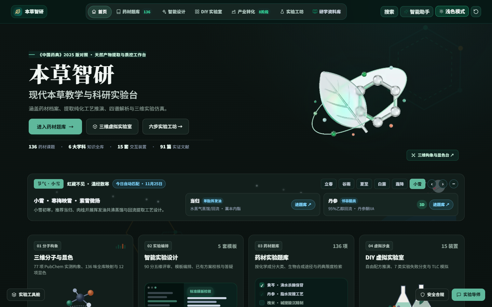
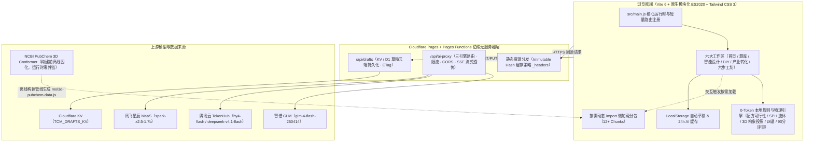

# 本草智研 · 现代本草智能实验设计工作台

> **辽宁中医药大学专属 · 作者独立设计开发 · 仅供非商业教学与科研研学使用（严禁商用）**

- **在线主站**：<https://bencaozhiyan-xixiyu.pages.dev/>
- **备用站点**：<https://tcm-chemistry-lab.pages.dev/>
- **GitHub 仓库**：<https://github.com/xixiyu954/tcm-chemistry-lab>
- **许可协议**：[辽宁中医药大学专属 · 非商业学术许可协议（LICENSE）](./LICENSE)

---

## 界面预览

| 首页 Bento 总览（宣纸亮色模式） | 首页 Bento 总览（黑曜石暗色模式） |
| :---: | :---: |
|  |  |

| 三维分子结构库（77 项 PubChem 实测构象） | 六步实验设计工坊（136 题库 · 动态视窗 · 五维雷达） |
| :---: | :---: |
|  |  |

---

## 一、项目定位与目标用户

### 1.1 项目定位
**本草智研**（`tcm-chemistry-lab`）是由作者独立设计并开发、**专属服务于辽宁中医药大学**的现代本草教学与科研实验设计工作台。  
项目对照 **2025 年版《中国药典》** 及中药学六大学科知识体系，将「药材档案检索 → 工艺参数核算与推演 → 化学机理与四谱解析 → 三维/物理装置仿真 → 数据统计拟合与报告导出 → 八阶段产业转化训练」整合为一套零安装、离线规则优先、支持云端多模型协同的浏览器端研学平台。

### 1.2 目标用户
- **辽宁中医药大学药学、中药学、制药工程等相关专业本科生与研究生**：用于实验课预习、自主方案设计、四谱识图训练、DIY 配方试错及规范实验报告撰写。
- **实验课程指导教师与教研团队**：用于课堂大屏演示（3D 分子构象、梨形分液漏斗物理流体分层、五维雷达驾驶舱全屏投影）、标准模板命题与自编课题五维评审。
- **中药小试—中试研发训练人员**：用于从实验室提取方案向炮制对照、剂型决策、三批复现质量评价、非线性中试放大与偏差 CAPA 调查推演的模拟训练。

> **教学科研免责说明**：本工作台提供的所有工艺核算、物理仿真、安全提示与 AI 辅助编排结果仅定位于**教学演练与实验方案预研参考**。进入实际实验室操作前，请务必核对现行《中国药典》、实验室安全规范与试剂 MSDS，并在指导教师复核下执行。

---

## 二、核心设计理念与关键设计决策

结合仓库全部提交记录、性能优化日志（[optimization-log.md](./optimization-log.md)）与阶段验收文档（[progress.md](./progress.md)），项目的演进始终围绕以下六项核心设计决策展开：

| 设计维度 | 关键决策 | 背后动因与演进背景 |
|---|---|---|
| **1. 离线规则优先，AI 作为受控协同层** | 题库、溶剂极性表、MSDS、物理仿真、动力学计算、90 分五维评分均由 **0-Token 本地确定性引擎** 驱动；云端 AI 仅负责开放式编排、点评与流式答疑，且断网或限流时自动降级本地兜底 | 早期直连单一模型曾出现超时、限流与 JSON 格式异常（提交 `ae1cbff`、`72a759a`）；确定性规则内核确保无网/弱网环境下教学主流程始终可用 |
| **2. 多分区工作台架构，避免单页堆叠** | 从早期单页控制台演进为 **六大独立工作区**（首页 / 药材题库 / 智能设计 / DIY 实验室 / 产业转化 / 六步工坊）+ 按需扩展舱，配合 Bento 总览与 `Ctrl+K` 全局检索（提交 `4483b28`、`264036e`） | 随着 136 题库、15 套装置、六科全库与八阶段转化主线不断扩充，按任务场景分区可显著降低认知负担与页面切换成本 |
| **3. 严格的两级按需懒加载架构** | 首页首屏仅加载核心运行时与轻量注册表；Three.js 3D 实验室、77 项 PubChem 3D 构象、六科知识全库、知识图谱 4.1~4.5、DIY 沙盒、产业转化、Chart.js、html2canvas 等 **12+ 重型分包** 全部通过动态 `import()` 按需加载（提交 `7cb66ef`、`9ce53dd`、`ba924b9`） | 解决纯静态基线首屏高达 2.7 MB / 27 个同步 `<script>`、Lighthouse 性能仅 44 分的瓶颈，在功能大幅扩容的同时将首屏传输压至 `424 KB`（Gzip） |
| **4. 标准化模板 + 90 分强制准入闭环** | 在智能实验设计中统一建立 **5 套标准化实验模板** 与 **90 分五维评审门槛**（提交 `4f60d27`、`130eb19`）；未达 90 分的临时草案仅驻留当前会话，禁止直接写入题库 | 防止无约束生成带来工艺失真或幻觉内容，同时以逐项扣分与参考修补引导学生迭代打磨科学性、安全性与质控细节 |
| **5. 数据来源分层与零幻觉边界** | 产业转化与档案视图明确标注「药典标准 / 法规文件 / 文献教材 / 用户实测 / 平台演算 / 示例数据」六类来源标签（提交 `a492090`），3D 分子坐标全部离线固化自 NCBI PubChem 官方 3D Conformer | 保证科研教学的严谨性，清晰区分法定药典标准与数学模拟估算值 |
| **6. 「本草典籍 × 精密仪器」精工去 AI 化设计** | v30~v32 重构全站视觉体系（提交 `520c8e5`、`fc3ee6d`、`862d8a0`）：以宣纸微暖白 `#f7f6f2`、矿物石青 `#0f4c3a`、朱砂印章 `#9a4a24` 与 1px 细线卡片替代泛滥的霓虹渐变、脉冲圆点与原始 Emoji，全站启用 `tabular-nums` 等宽数字、矢量图标与护眼黑曜石暗色模式 | 消除快速迭代积累的视觉噪声与模板感，使工作台符合高校实验室仪器软件的清晰度与长期阅读舒适性 |

---

## 三、主要功能全景

### 1. 六大核心工作区
1. **首页总览（Bento 导航 + 24 节气氛围）**：以 8 张高信息密度功能卡直达全站能力，内置自动匹配公历日期的 24 节气水墨氛围条（按节气推荐当季代表药材与 3D 构象），底部直连六大学科知识库。
2. **药材实验题库（136 项 · 六大学科档案）**：覆盖 11 大化学成分类别与 136 项药材/复方课题，支持关键词、生物合成途径、含 3D 分子、经典复方、绿色工艺、炮制对照、中西医对照等多维筛选与收藏排序；右侧四标签档案卡整合化学特性、工艺与制剂、药典限度与质控、关联文献与知识库章节直达，正文中 77 种核心成分自动转为可点击 3D 构象芯片。
3. **智能实验设计（三引擎协同 + 5 套标准模板）**：统一驱动「课题评审竞技（90 分准入）」「方案模板编排」「已有方案校核」「实验助教答疑」四大板块，支持 **智谱 GLM / 腾讯云 TokenHub / 讯飞星辰 MaaS** 三引擎自动故障切换与手动指定，并具备完整本地规则兜底。
4. **DIY 创意实验室**：
   - **自由配方沙盒**：打通 `136 药材 × 15 溶剂 × 8 装置`（16,320+ 组合空间），实时 0-Token 演算极性光谱匹配尺、提取动力学曲线、提取液现象预览瓶（丹红/酶解墨绿/皂苷泡沫/暴沸气泡）及冲突诊断，支持 4 方案最优高亮对比槽与一键导入六步工坊。
   - **7 大经典失败分支与 FMEA / CAPA 应急实训**：模拟暴沸冲料、黄芩酶解变绿、分液乳化、热敏降解等实验事故及现场 3 选 1 应急决策。
   - **复方配伍与 TLC 三光源显色 / 15 套交互仿真装置库 / 专业计算工具箱**（MSDS 废液查询、TLC 展开剂极性调优、$L_9(3^4)$ 正交极差分析、旋蒸真空降沸计算等）。
5. **八阶段产业转化训练主线**：内置丹参（脂水双提）、黄芩、薄荷、延胡索 4 大标杆项目，并支持导入全库 136 项药材，贯通「产品定位 → 药材与炮制 → 提取纯化（9 维加权最优决策）→ 浓缩干燥（热敏/挥发保留率模拟）→ 制剂成型 → 质量评价（三批 RSD 与通则 9001）→ 中试放大与偏差 CAPA → 注册与转化报告」。
6. **六步实验设计工坊**：左侧常驻工艺参数配置单（支持本地自动保存与 Cloudflare KV 云端草稿同步），右侧常驻实时化学萃取动态视窗与五维工艺健康度雷达，主区按「01 选材（全部 136 题）→ 02 定题与放大核算 → 03 原理与四谱 → 04 装置与流程 → 05 数据拟合与统计 → 06 规范 A4 报告导出（PNG 长图 / Word / 打印）」形成完整闭环。

### 2. 按需扩展舱与全库知识体系
- **三维分子结构库（77 项 PubChem 实测 3D 构象）& 粒子显色实验室（12 项经典检识反应）**：支持球棍/骨架/空间填充三模式、隐显氢原子、官能团整组悬停/点击高亮、10 大分类检索、136 题直连跳转与 91 篇实证文献自动匹配；12 项检识反应支持双管空白对照、滴数控制与倍速重播。
- **第一人称 Three.js 3D 虚拟实验室 / 液液萃取物理流体仿真 / 3D 五维雷达驾驶舱**：
  - Three.js 3D 实验室支持第一人称漫游与「丹参 95% 乙醇回流提取」7 步 SOP（含 17 件开放式试剂架物资与未通冷凝水加热安全互锁）；
  - 液液萃取流体仿真采用 SPH 粒子物理内核，实时读取极性密度表模拟倾倒、湍动乳化、密度差分层、饱和 NaCl 盐析破乳及下口旋塞分液安全拦截（内置 7 套题库萃取场景预设）；
  - 五维雷达驾驶舱支持 360° 拖拽旋转、绿色基准线框对照、136 课题快速切换与全屏投影演示。
- **交互式四谱工作站（全部 11 大类）**：覆盖 UV（诊断试剂位移叠加）、IR（官能团特征分区）、¹H-NMR（多重峰劈裂与积分阶梯曲线）、MS（中性丢失裂解路径），支持 1×~6× 缩放平移、136 课题定位、PNG 导出与猜峰计分训练。
- **知识图谱与可视化探索中心（4.1~4.5）**：包含 136 项课题工艺链路知识图谱、12 星极性三维宇宙、6 套工艺流水线沙盘、140 套导演时间轴可导出课件与 136 味对比显微镜。
- **六大学科知识全库、实践资料汇编与四库收集图鉴**：收录 6 册学科知识库与 7 大实践汇编模块，支持全文检索、章节直达及四库全集图鉴（136 药材 / 77 分子 / 15 装置 / 91 文献 / 8 成就徽章）。
- **实时实验导师与安全合规督察**：对称悬浮于右下角，实时同步当前工作区上下文与工艺参数，提供流式问答与实验安全自检清单。

---

## 四、技术架构与核心实现原理

### 4.1 系统总体架构



### 4.2 关键实现思路

1. **轻量前端工程化与按需分包（`vite.config.js`）**
   - 采用 **Vite 6 + Tailwind CSS 3 静态编译 + 原生 ES Modules / IIFE 渐进式混合架构**，无需大型前端框架运行时开销，并完整保留 `window.TCM_LAB_API` 与 `window.TCM_V16_PORTAL.registerExtension()` 扩展接口。
   - 通过 `manualChunks` 将重型依赖与扩展模块彻底隔离为按需异步分包：`vendor-three`（137 KB gz）、`suite-visuals`（118 KB gz）、`suite-knowledge`（84 KB gz）、`vendor-chart`（57 KB gz）、`route-diy`（49 KB gz）、`vendor-html2canvas`（48 KB gz）、`route-translation`（46 KB gz）、`modal-ai-review`（33 KB gz）、`suite-explore`（26 KB gz），确保首页首屏零冗余加载。
   - 首页启动时将隐藏六步工坊的首次 DOM 水合让出至 `requestAnimationFrame` 首帧之后执行，保障首屏 Hero 快速绘制。

2. **三引擎混合 AI 边缘代理与安全容错（`functions/api/ai-proxy.js` + `cloud-ai.js`）**
   - **零密钥前端暴露**：三家 API 密钥（`ZHIPU_API_KEY`、`TENCENT_API_KEY`、`XUNFEI_API_KEY`）仅配置在 Cloudflare Pages 服务端加密环境变量中；边缘函数内置 Origin 白名单校验与单 IP 限流（`24 req/min`）。
   - **智能调度与故障转移**：支持自动混合调度（按任务特点选型并在 429/5xx/超时时沿候选链自动切换）与手动指定单引擎，支持 SSE 流式输出；前端内置栈式 JSON 容错修复解析器与本地 24h 缓存，断网时无缝回退至本地规则引擎。

3. **确定性物理化学仿真与离线分子数据管线**
   - **77 项 PubChem 3D 构象**：通过离线脚本拉取 NCBI PubChem PUG-REST 3D Conformer 坐标、键级与理化参数（MW / XLogP3 / TPSA），经共价键拓扑图自动标注官能团原子组；前端以自研 Canvas 3D 透视投影与深度排序绘制，规避低端设备 WebGL 兼容性风险并保持高帧率流畅交互。
   - **液液萃取 SPH 流体仿真**：读取 `SOLVENT_POLARITY_TABLE` 实时求解浮力驱动 $\Delta\rho = \rho_{\text{有机}} - \rho_{\text{水}}$，模拟梨形分液漏斗内倾倒、湍动乳化、密度差分层、饱和 NaCl 盐析破乳（水相密度 $1.00 \to 1.19$）与下口旋塞分液安全拦截。
   - **自由配方可行性引擎**：融合极性窗口匹配、耐热上限、黄芩酶解温区（30~72 ℃ 水相）、多糖醇沉、溶剂沸点超限与含卤毒性判定，输出指数饱和—热降解耦合动力学曲线与可行性评分。

4. **草稿本地—云端双轨持久化（`functions/api/drafts.js` + `src/modules/cloud-drafts.js`）**
   - 本地通过防抖自动落盘 `localStorage`，云端通过 Cloudflare KV（`TCM_DRAFTS_KV`，30 天 TTL，单份上限 512 KB，支持 ETag 与 `?draft=<id>` 链接恢复）或 D1 数据库实现跨设备草稿同步。

5. **边缘缓存与构建优化（`_headers`）**
   - `/assets/*` 与 `/vendor/*` 配置 `max-age=31536000, immutable`；`/index.html` 与 `/` 配置 `max-age=0, must-revalidate`；`/api/*` 禁用缓存（`no-store`）。

---

## 五、开发过程与版本迭代历程（92 次真实提交）

项目自 **2026-11-21** 起至 **2026-11-25** 共经历 **92 次提交**，完整走过六个演进阶段：

| 阶段 | 时间与代表提交 | 核心演进内容 | 改进动因 |
|---|---|---|---|
| **阶段一：原型与六步工坊奠基** | `2026-11-21`<br>`d9cd637` → `3c55182` | 由单页实验控制台升级为六步实验设计工坊，建立课题配置与存档兼容规范 | 将零散的计算工具串联为符合高校教学逻辑的六步实验设计闭环 |
| **阶段二：AI 容错与国内访问演进** | `2026-11-21 ~ 11-23`<br>`14d69ce` → `6ec7bec` | 依次演进通义千问反代 → Netlify + 智谱 GLM SSE 流式代理 → 迁移至 Cloudflare Pages Functions，并本地化第三方依赖 | 根治早期同步代理超时 502、JSON 截断报错及境外 CDN 加载不稳定问题 |
| **阶段三：多分支工作台与科研主线扩容（v2 ~ v18）** | `2026-11-22 ~ 11-23`<br>`fabd4d5` → `f88c6ce` | 陆续建成 119 题库、15 套动态装置、四谱/标曲拟合、双课题对比、DIY 创意实验室、项目中枢（v15）、六大独立工作区（v16）、90 分严审闭环（v17）与八阶段产业转化主线（v18） | 支撑从基础实验向综合设计与产业转化训练拓展，解决单页堆叠与输入法重绘中断等体验痛点 |
| **阶段四：Vite 工程化重构与 12 轮性能优化** | `2026-11-24`<br>`7cb66ef` | 引入 Vite 6 与 Rollup 分包分析，完成 Rounds 1–12 渐进式拆分（详见 [optimization-log.md](./optimization-log.md)），上线 KV/D1 云草稿接口 | 纯静态基线首屏达 2.7 MB、27 个同步脚本、Lighthouse 性能仅 44 分；重构后首屏大幅瘦身且零阻塞 |
| **阶段五：三维视觉舱、六科全库与三引擎协同（v19 ~ v29）** | `2026-11-24 ~ 11-25`<br>`264036e` → `130eb19` | 上线 Bento 首页与 24 节气氛围、PubChem 3D 分子库、Three.js 3D 实验室、SPH 流体仿真、四谱工作站、3D 雷达驾驶舱、六大学科全库、136 项六科档案题库、自由配方沙盒与 7 大失败分支、90 分 AI 竞技场与实时导师/安全督察、知识图谱 4.1~4.5，并升级为智谱 + 腾讯 + 讯飞三引擎混合路由与 5 套标准模板 | 将抽象化学机理可视化与可交互化，用三引擎容灾 + 模板规范解决单模型限流与格式漂移 |
| **阶段六：去 AI 化精工重构、全库满配与全端打磨（v30 ~ v32）** | `2026-11-25`<br>`520c8e5` → `862d8a0` | 重塑「本草典籍 × 精密仪器」视觉体系与矢量图标；3D 分子库由 6 项扩充至 **77 项 PubChem 实测构象**，全站所有扩展仓贯通 136 课题与 91 篇文献，按需彻底移除 AR 模块；品牌升级为「现代本草科研与实验设计」；修复工坊桌面侧栏与移动端步进条遮挡、暗色雷达/沙盒对比度、Step 1 全库 136 项对齐与矢量 Favicon | 通过多轮桌面/暗色/移动端实景截图巡检，逐项根治视觉模板感、资料覆盖缺口与真实遮挡缺陷 |

### 实测工程质量基线（v32）
- **生产构建**：`vite build` 耗时 `3.83s`，首页传输体积 `424 KB`（Gzip）
- **Lighthouse 审计（Mobile 4G 节流）**：Accessibility **100** · Best Practices **100** · SEO **100** · Performance **86** · CLS **0**
- **Playwright 自动化端到端实测（Desktop 1440×900 + Mobile 390×844）**：LCP `232 ms` / CLS `0.0015`，7 大核心功能回归与全部扩展仓巡检通过，0 控制台报错、0 页面异常、0 懒加载泄露

---

## 六、项目目录结构

```text
tcm-chemistry-lab/
├── index.html                        # 主入口与工坊骨架（矢量 SVG 图标、SEO/Schema 元数据）
├── manifest.webmanifest              # PWA 清单
├── vite.config.js                    # Vite 6 构建、manualChunks 分包与 robots/sitemap 生成
├── _headers                          # Cloudflare Pages 静态资源缓存策略
├── LICENSE                           # 辽宁中医药大学专属 · 非商业学术许可协议
├── app.js                            # 核心状态管理、136 题库与六步工坊主引擎
├── cloud-ai.js                       # 前端三引擎客户端、SSE 流式读取、JSON 容错修复与 24h 缓存
├── lab-v16-portal.js / .css          # 六大工作区路由、顶栏/页脚与扩展注册机制
├── lab-v18-translation*.js / .css    # 八阶段产业转化训练主线与数据规则库
├── lab-v20-mol3d-particles.js        # 77 项 PubChem 3D 分子渲染引擎与 12 项粒子显色实验室
├── lab-v21-spectra-lab.js            # 11 大类交互式四谱工作站与猜峰训练
├── lab-v22-visual-suite-pro.js/.css  # 3D 体验舱容器（虚拟实验室 / 流体仿真 / 五维雷达驾驶舱）
├── docs/screenshots/                 # 项目展示实景截图
├── src/
│   ├── main.js                       # Vite 模块入口
│   ├── data/
│   │   ├── mol3d-pubchem-data.js     # 77 项 PubChem 3D 构象离线数据集（按需懒加载）
│   │   ├── knowledge-hub-data.js     # 六大学科知识全库与实践资料汇编（按需懒加载）
│   │   └── knowledge-index.js        # 全文检索索引
│   ├── modules/                      # v19~v29 独立功能模块（Bento 首页、24 节气、Three.js 3D 实验室、SPH 流体、
│   │                                 # 3D 驾驶舱、四库图鉴、自由配方沙盒、失败分支、90 分竞技、AI 导师、安全督察、知识图谱）
│   ├── routes/                       # 各大扩展舱与工作区的按需懒加载代理与 Chunk 入口
│   └── styles/                       # 分模块样式与 lab-v30-craft-deai.css 统一精工视觉系统
├── functions/api/
│   ├── ai-proxy.js                   # Cloudflare Pages Functions 三引擎混合 AI 代理
│   ├── drafts.js                     # 云端实验草稿 CRUD（KV / D1）
│   └── drafts.schema.sql             # 可选 D1 建表脚本
├── optimization-log.md               # Rounds 0~12 性能优化基线与实测日志
└── progress.md                       # 蓝图功能验收与版本演进留痕
```

---

## 七、本地开发与部署说明

### 本地运行（需 Node.js 18+）
```bash
git clone https://github.com/xixiyu954/tcm-chemistry-lab.git
cd tcm-chemistry-lab
npm install

# 启动本地开发服务器（默认 http://localhost:5173）
npm run dev

# 生产构建与本地预览
npm run build
npm run preview
```

### Cloudflare Pages 部署（推荐）
1. 在 Cloudflare Pages 关联本仓库 `main` 分支：
   - **构建命令**：`npm run build`
   - **输出目录**：`dist`
2. **启用云端草稿同步**：在 `Settings → Functions → Bindings` 绑定 KV 命名空间 `TCM_DRAFTS_KV`（或绑定 D1 数据库 `TCM_DRAFTS_DB`）。
3. **启用三引擎智能协同**：在 `Settings → Environment variables` 按需配置服务端加密密钥（配置任意 1~3 个均自动生效，严禁硬编码到前端或仓库）：
   - `ZHIPU_API_KEY`（智谱 GLM）
   - `TENCENT_API_KEY`（腾讯云 TokenHub）
   - `XUNFEI_API_KEY`（讯飞星辰 MaaS）

---

## 八、后续演进规划（Roadmap）

- [ ] **3D 虚拟实验室场景扩展**：在现有「丹参 95% 乙醇回流提取」7 步 SOP 基础上，按同一 Three.js 框架扩展减压旋转蒸发仪、HPLC-DAD 色谱操作等互动实训场景。
- [ ] **辽药与特色课程案例扩充**：结合辽宁中医药大学特色道地药材与校内实验课程体系，持续丰富辽产药材档案、炮制对照案例与教学考核题库。
- [ ] **工程自动化治理**：引入 GitHub Actions 自动构建与回归检查流程，并逐步归档或清理历史过渡脚本以进一步精简仓库体积。

---

## 九、版权归属、使用许可与反馈

- **原创与归属声明**：本项目由作者本人独立设计开发，**辽宁中医药大学专属**，仅限校内教学、科研训练与非商业学术交流使用。**严禁任何形式的商业使用、收费封装、付费镜像或未经作者书面授权的商业二次分发**，完整条款详见 [LICENSE](./LICENSE)。
- **反馈与勘误**：欢迎辽宁中医药大学师生及同行通过 GitHub Issues 或邮件（`Chenovo495666@163.com`）提交药典标准勘误、特色药材课题建议与功能改进意见。
