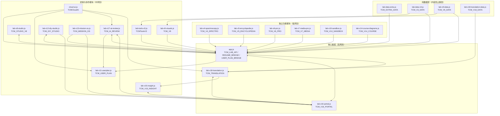

# tcm-chemistry-lab 基线审计报告（Baseline Audit）

- **审计时间**：2026-11-24
- **仓库地址**：`https://github.com/xixiyu954/tcm-chemistry-lab`
- **基线 Commit**：`f88c6ce16875ef6cd3f8068c6b2a3c60441ce36a`（`main` 分支，未修改任何源码）
- **线上站点**：`https://bencaozhiyan-xixiyu.pages.dev/`
- **测量环境**：本地 Node HTTP 静态服务（启用标准 Gzip 压缩，与 Cloudflare Pages 传输语义对齐），Chrome Headless + Lighthouse（默认移动端模拟节流）+ Playwright 1440×900 实测 CWV 与功能回归。

---

## 一、文件体积统计与 Top 15 大文件

### 1.1 分类体积总览

| 资产分类 | 文件数 | 原始体积 (Raw) | Gzip 传输体积 | 说明 |
| --- | ---: | ---: | ---: | --- |
| 第三方依赖 (`vendor/*.js`) | 4 | 1,139.98 KB | 314.54 KB | Tailwind JIT / Lucide / Chart.js / html2canvas |
| 前端业务 JS（不含 `functions/`） | 22 | 1,354.99 KB | 431.03 KB | `app.js` + `cloud-ai.js` + `lab-*` |
| 前端 JS 合计 | 26 | 2,494.98 KB | 745.57 KB | 全部未压缩、未 Tree-shake |
| 前端 CSS (`*.css`) | 4 | 114.60 KB | 26.72 KB | `styles.css` + `v15/v16/v18` 样式 |
| HTML 与 PWA 清单 | 2 | 107.84 KB | 26.23 KB | `index.html` + `manifest.webmanifest` |
| **前端总计** | **32** | **2,717.42 KB** | **798.52 KB** | **对比后续 Vite 产物的核心基线** |
| 服务端 Functions (`functions/api/ai-proxy.js`) | 1 | 8.84 KB | — | Cloudflare Pages Function，不计入前端包 |

### 1.2 Top 15 最大文件（全仓库，含 HTML）

| 排名 | 文件路径 | 原始字节 | 原始大小 (KB) | 类型 |
| ---: | --- | ---: | ---: | --- |
| 1 | `app.js` | 440,344 | 430.02 | 业务 JS |
| 2 | `vendor/tailwindcss-3.4.17.min.js` | 407,279 | 397.73 | Vendor JS（运行时编译器） |
| 3 | `vendor/lucide-0.460.0.min.js` | 355,975 | 347.63 | Vendor JS |
| 4 | `vendor/chart-4.4.1.umd.min.js` | 205,399 | 200.58 | Vendor JS |
| 5 | `vendor/html2canvas-1.4.1.min.js` | 198,689 | 194.03 | Vendor JS |
| 6 | `lab-v18-translation.js` | 121,703 | 118.85 | 业务 JS |
| 7 | `index.html` | 109,038 | 106.48 | HTML 入口 |
| 8 | `lab-data-extra.js` | 96,477 | 94.22 | 数据 JS（核心资产） |
| 9 | `lab-v13-mission-os.js` | 64,176 | 62.67 | 业务 JS |
| 10 | `lab-v16-portal.js` | 64,025 | 62.52 | 业务 JS（门户路由） |
| 11 | `lab-data-v3.js` | 61,730 | 60.28 | 数据 JS（核心资产） |
| 12 | `lab-v18-translation-data.js` | 57,666 | 56.31 | 数据 JS（核心资产） |
| 13 | `lab-v17-ai-review.js` | 48,504 | 47.37 | 业务 JS |
| 14 | `lab-v15-insight.js` | 42,139 | 41.15 | 业务 JS |
| 15 | `lab-v9-data.js` | 39,275 | 38.35 | 数据 JS（核心资产） |

> 注：CSS 文件中最大的是 `styles.css`、`lab-v16-portal.css`、`lab-v18-translation.css`、`lab-v15-insight.css`（合计 114.60 KB）；若只统计 JS/CSS Top 15，第 15 位为 `lab-v8-studio.js`（37,853 bytes / 36.97 KB）。

---

## 二、`index.html` 脚本加载审计与 Lighthouse / CWV 基线

### 2.1 `<script>` 标签统计（共 27 个）

- **`<head>` 内（4 个）**：
  - **3 个同步阻塞加载 (`sync`)**：`vendor/tailwindcss-3.4.17.min.js`、`vendor/chart-4.4.1.umd.min.js`、`vendor/lucide-0.460.0.min.js`（共 968.6 KB 原始 / ~266 KB Gzip 阻塞首屏解析渲染！）
  - **1 个 `defer` 加载**：`vendor/html2canvas-1.4.1.min.js`
- **`<body>` 底部（23 个）**：
  - **1 个同步内联脚本**：第 1201 行，无痕净享模式早启动脚本（清理 6 个 `localStorage` key，导致刷新即重置草稿）。
  - **22 个同步顺序加载 (`sync`)**：按严格顺序加载 `lab-data-extra.js` → `lab-data-v3.js` → `lab-v4` → `lab-v5` → `lab-tools-v3` → `lab-v6` → `lab-v7` → `lab-v9-data` → `lab-v8` → `lab-v9-visuals` → `lab-v10` → `lab-v11` → `lab-v12` → `lab-v13` → `lab-v14` → `cloud-ai` → `app` → `lab-v15` → `lab-v16` → `lab-v17` → `lab-v18-data` → `lab-v18`。
- **`<link rel="stylesheet">` 标签（4 个）**：`styles.css?v=24`、`lab-v15-insight.css?v=16`、`lab-v16-portal.css?v=22`、`lab-v18-translation.css?v=2`（均通过 `?v=N` 手动管理缓存，无 contenthash）。
- **内联事件处理器**：`index.html` 中 0 个内联 `onclick`/`onchange` 属性，事件全部在 JS 中绑定，利于模块化迁移。

### 2.2 Lighthouse 四项分数与 Core Web Vitals 基线

| 指标维度 | 指标项 | 基线实测值 | 备注 |
| --- | --- | ---: | --- |
| **Lighthouse 分数** | Performance（性能） | **44** | 主要瓶颈：`<head>` 3 个巨型同步 vendor 脚本 + 22 个同步 JS 串行下载执行 |
| **Lighthouse 分数** | Accessibility（可访问性） | **87** | 扣分项：`heading-order`、`meta-viewport` 含 `user-scalable="no"` |
| **Lighthouse 分数** | Best Practices（最佳实践） | **100** | — |
| **Lighthouse 分数** | SEO | **100** | 已有 meta description / OG，后续动态化需保持并补充 canonical/sitemap/JSON-LD |
| **Lighthouse 指标（模拟移动 4G）** | FCP | 5,072 ms | — |
| **Lighthouse 指标（模拟移动 4G）** | LCP | 6,222 ms | — |
| **Lighthouse 指标（模拟移动 4G）** | TBT | 879 ms | — |
| **Lighthouse 指标（模拟移动 4G）** | CLS | 0.0000 | — |
| **Lighthouse 指标（模拟移动 4G）** | Total Byte Weight | 826,247 B (806.9 KB) | 含响应头与全量 Gzip 资源 |
| **Playwright 实测 CWV（桌面 1440×900）** | LCP | 444 ms | 真实交互场景 |
| **Playwright 实测 CWV（桌面 1440×900）** | CLS | 0.3202 | `lab-v16-portal.js` 在首绘后注入门户首页导致布局偏移 |
| **Playwright 实测 CWV（桌面 1440×900）** | INP | 296 ms | 78 次交互采样峰值 |

---

## 三、`lab-v*` 模块全局变量依赖图与迁移风险评估

所有 22 个业务/数据 JS 文件均已采用 IIFE 封装，对外仅暴露单一（或极少）`window.*` 全局接口，无顶层变量污染，模块化基础极佳。

### 3.1 模块依赖关系图（Mermaid）

### 3.2 模块依赖与迁移风险分级表

| 模块文件 | 体积 (KB) | 对外暴露全局 (`window.*`) | 依赖全局 | 被引用方 | 迁移风险 | 推荐迁移顺序 |
| --- | ---: | --- | --- | --- | :---: | --- |
| `lab-v4-spectroscopy.js` | 31.67 | `TCM_V4_SPECTRO` | 无 | `app.js` | **低** | 第 1 批（优先） |
| `lab-v5-encyclopedia.js` | 35.33 | `TCM_V5_ENCYCLOPEDIA` | 无 | `app.js` | **低** | 第 1 批（优先） |
| `lab-v6-pro.js` | 16.25 | `TCM_V6_PRO` | 无（通过 `initProSuite(api)` 注入） | `app.js` | **低** | 第 1 批 |
| `lab-v7-media-pro.js` | 27.11 | `TCM_V7_MEDIA` | 无 | `app.js` | **低** | 第 1 批 |
| `lab-v10-sandbox.js` | 35.86 | `TCM_V10_SANDBOX` | 无 | `app.js` | **低** | 第 1 批 |
| `lab-v14-course-diagrams.js` | 28.39 | `TCM_V14_COURSE` | 无 | `app.js` | **低** | 第 1 批 |
| `lab-v9-data.js` | 38.35 | `TCM_V9_DATA` | 无 | `app.js`, `lab-v9-visuals.js` | **低** | 数据模块迁移轮 |
| `lab-v18-translation-data.js` | 56.31 | `TCM_V18_DATA` | 无 | `lab-v18-translation.js` | **低** | 数据模块迁移轮 |
| `lab-tools-v3.js` | 21.94 | `TCMToolsV3` | `TCM_V3_DATA` | `app.js` | **中** | 第 2 批 |
| `lab-v9-visuals.js` | 36.77 | `TCM_V9` | `TCM_V9_DATA` | `app.js` | **中** | 第 2 批 |
| `lab-v8-studio.js` | 36.97 | `TCM_STUDIO_V8` | `TCM_RESUME_BRIDGE` | `app.js` | **中** | 第 2 批 |
| `lab-v11-userplan.js` | 29.45 | `TCM_USER_PLAN` | `TCM_USER_PLAN_BRIDGE`, `TCMCloudAI`, `TCM_AI_REVIEW` | 无（自注册 DOM） | **中** | 第 2 批 |
| `lab-v12-diy-studio.js` | 29.08 | `TCM_DIY_STUDIO` | `TCM_USER_PLAN_BRIDGE` | `app.js`, `lab-v16-portal.js` | **中** | 第 2 批 |
| `lab-v13-mission-os.js` | 62.67 | `TCM_MISSION_OS` | 无 | `app.js`, `lab-v16-portal.js` | **中** | 第 2 批 |
| `lab-v15-insight.js` | 41.15 | `TCM_V15_INSIGHT` | `TCM_V16_PORTAL`, `TCM_TRANSLATION` | `lab-v16-portal.js` | **中** | 第 2 批（双向引用） |
| `lab-v17-ai-review.js` | 47.37 | `TCM_AI_REVIEW` | `TCM_LAB_API`, `TCMCloudAI`, `TCM_V16_PORTAL` | `app.js`, `v11`, `v16` | **中** | 第 2 批 |
| `lab-v16-portal.js` | 62.52 | `TCM_V16_PORTAL`, `lucide`(兜底) | `TCM_LAB_API`, `TCM_RESUME_BRIDGE`, `v12/v13/v15/v17/v18` | `app.js`, `v15/v17/v18` | **高** | 第 3 批（路由中心） |
| `lab-v18-translation.js` | 118.85 | `TCM_TRANSLATION` | `TCM_LAB_API`, `TCMCloudAI`, `TCM_V16_PORTAL`, `TCM_V18_DATA` | `v15`, `v16` | **高** | 第 3 批（大引擎） |
| `app.js` | 430.02 | `TCM_LAB_API`, `TCM_RESUME_BRIDGE`, `TCM_USER_PLAN_BRIDGE` | 全部 `v4~v14` + `lab-data-*` + `Chart/lucide/html2canvas` | `v8/v11/v12/v16/v17/v18` | **高** | 保持桥接，最后拆分 |

---

## 四、功能回归测试基准清单（Baseline Regression Checklist）

以下 6 大核心功能 + 全局接口完整性均已在未修改基线上通过自动化回归验证（0 console error、0 page error、0 failed request）：

- [x] **全局接口与数据完整性**：22 个 `window.TCM_*` 全部就绪，`window.TCM_V16_PORTAL.registerExtension` 可用；内置数据计数确认：`topics = 119`、`rigs = 15`、`literature = 85`、`univCases = 38`。
- [x] **1. 六大工作区切换**：`home`（首页）、`bank`（药材题库）、`ai`（智能设计）、`diy`（DIY 实验室）、`translation`（产业转化）、`workflow`（实验工坊）全部可正常切换并激活。
- [x] **2. Ctrl+K 检索**：快捷键 `Ctrl+K` 正常呼出 `#cmdPaletteModal`，输入「黄芩」返回 3 条匹配结果，`Esc` 正常关闭。
- [x] **3. 六步工坊联动**：`workflow` 工作区 01~06 步骤切换正常；左侧 `#cfgMass` 调至 `200 g` 实时联动 `#cfgMassLbl` 与 `#cfgSolventEst`；Step 3 四谱解析卡 (`v4`)、Step 5 UV 标曲拟合 (`v4`) 正常挂载。
- [x] **4. 八阶段产业转化**：`translation` 工作区渲染完整 8 阶段（`position → herb → extract → dry → form → quality → scale → register`），阶段点击切换正常。
- [x] **5. 报告导出**：Step 6 正式报告 A4 预览区正常渲染（正文 2,190 字），`html2canvas` 可用，长图/PDF/Word/精简册/原始手写记录单切换按钮齐全且无报错。
- [x] **6. 暗色模式**：点击 `#btnToggleDarkLab` 可正确切换 `body.dark-lab` 开启与关闭。
